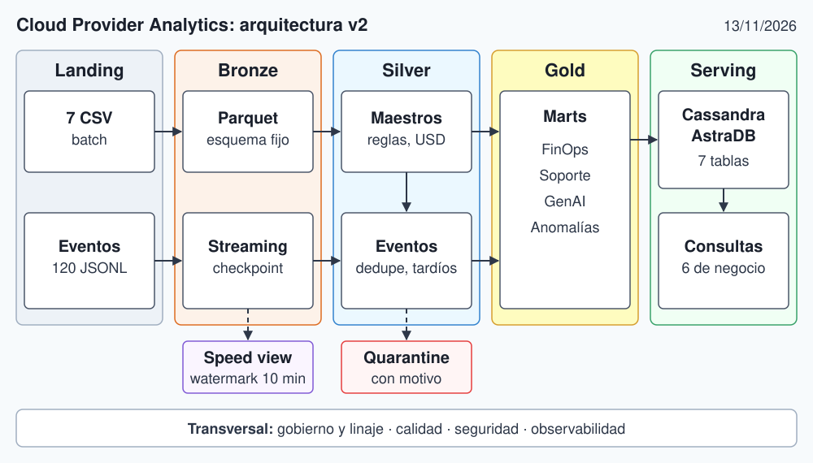

# Cloud Provider Analytics - 72.80 Big Data (ITBA)

Pipeline de datos para un proveedor cloud: ingesta, limpieza, agregación y serving para
analítica de FinOps, Soporte y Producto.

Grupo 13: Olivia Garcia (61071), Abril Lombardo (63655) y Agustín Morantes (61306).

**Estado: segunda entrega.** El pipeline corre completo, desde Landing hasta Cassandra/AstraDB.
Lo que falta para la entrega final está en [`docs/backlog.md`](docs/backlog.md).

## Arquitectura



Usamos una arquitectura Medallion (Landing, Bronze, Silver y Gold) en Parquet, con un patrón
híbrido: batch para las 7 fuentes maestras y la facturación, y Structured Streaming para
`usage_events_stream`. Desde Gold cargamos tablas en Cassandra/AstraDB diseñadas a partir de las
consultas. Las decisiones de diseño están en [`docs/decisiones.md`](docs/decisiones.md).

El pipeline se divide en etapas que se pueden correr juntas o por separado:

| Etapa | Módulo | Qué hace |
|---|---|---|
| `bronze-batch` | `cpa/bronze_batch.py` | Lee los 7 CSV con esquema explícito, agrega `ingest_ts` y `source_file`, deduplica por clave y escribe Bronze en Parquet |
| `silver-masters` | `cpa/silver_masters.py` | Aplica las reglas de calidad, manda a quarantine lo que no pasa, normaliza montos a USD y hashea los emails |
| `bronze-stream` | `cpa/bronze_stream.py` | Lee los JSONL con Structured Streaming y escribe Bronze, con checkpoint |
| `silver-events` | `cpa/silver_events.py` | Con `foreachBatch`: calidad, dedupe por `event_id`, eventos tardíos, joins con los maestros y features |
| `compact` | `cpa/silver_events.py` | Compacta Silver de eventos a un archivo por fecha |
| `gold` | `cpa/gold.py` | Arma los 7 marts de FinOps, Soporte, GenAI y anomalías |
| `serving` | `cpa/serving.py` | Crea las tablas y carga Gold en Cassandra/AstraDB |
| `queries` | `cpa/queries.py` | Corre las consultas de negocio y guarda el CQL y los resultados |
| `speed-view` | `cpa/bronze_stream.py` | Agregación por ventanas con watermark nativo, para la demo |
| `idempotency` | `cpa/run_pipeline.py` | Vuelve a correr todo y reprocesa sin checkpoint, comparando conteos |
| `evidence` | `cpa/evidence.py` | Genera los archivos de `evidence/` |
| `reset` | `cpa/run_pipeline.py` | Borra todo lo derivado; Landing no se toca |

## Cómo correrlo con Docker

Hace falta Docker Desktop (o Docker Engine con Compose v2) y unos 4 GB de RAM libres. Python
3.11, OpenJDK 17, PySpark 3.5.1 y Cassandra 4.1 vienen en los contenedores.

```bash
git clone https://github.com/agustinmorantes/tp-big-data.git && cd tp-big-data

# 1. Descomprimir el dataset de la cátedra en data/datalake/landing/
#    (7 CSV y la carpeta usage_events_stream/ con 120 JSONL). No está en el repo.

# 2. Construir la imagen y levantar Cassandra (la primera vez tarda unos minutos)
docker compose -f infra/docker-compose.yml build
docker compose -f infra/docker-compose.yml up -d cassandra    # esperar a que esté "healthy"

# 3. Correr el pipeline completo (6 a 8 minutos)
docker compose -f infra/docker-compose.yml run --rm pipeline \
  python -m cpa.run_pipeline reset all speed-view idempotency evidence

# 4. Correr los tests (alrededor de 1 minuto)
docker compose -f infra/docker-compose.yml run --rm pipeline python -m pytest -q
```

Las etapas se pueden combinar como se quiera, por ejemplo
`python -m cpa.run_pipeline gold serving queries`. Qué queda después de correr:

- El lake en `data/datalake/{bronze,silver,gold,quarantine}/`, los checkpoints en `_checkpoints/`
  y las métricas en `_meta/run_metrics.jsonl`.
- El log de la corrida en `logs/pipeline_<run_id>.log`.
- La evidencia en `evidence/segunda-entrega/`.

Para consultar Cassandra a mano:

```bash
docker exec -it cpa-cassandra cqlsh -k cloud_provider_analytics
```

En [`cql/02_queries.cql`](cql/02_queries.cql) están las consultas con valores de ejemplo.

## Cómo correrlo en Google Colab con AstraDB

1. En la consola de Astra, crear una base Serverless y agregarle el keyspace
   `cloud_provider_analytics` desde la interfaz (Astra no deja crearlo por CQL). Generar un token
   con rol *Database Administrator* y descargar el Secure Connect Bundle.
2. Abrir [`notebooks/02_pipeline_segunda_entrega.ipynb`](notebooks/02_pipeline_segunda_entrega.ipynb)
   en Colab y correr las celdas en orden. El notebook clona el repo, instala las dependencias,
   pide el zip del dataset, el bundle y el token (con `getpass`, así no queda guardado), corre el
   pipeline y muestra la evidencia.

Para usar AstraDB desde Docker o en local: copiar `config/astra.env.example` a
`config/astra.env`, completar el token, copiar el bundle a `config/` y agregar
`-e CPA_SERVING_TARGET=astra` al `docker compose run`.

## Configuración

La configuración está en [`config/pipeline.toml`](config/pipeline.toml): rutas, Spark, ritmo del
streaming (`max_files_per_trigger`), umbral de eventos tardíos, reglas de calidad, umbral de
anomalías y destino del serving. Si un valor está en más de un lugar, gana la variable de
entorno, después `config/astra.env` y por último `pipeline.toml`.

Variables de entorno: `CPA_CONFIG`, `CPA_SERVING_TARGET` (`cassandra` o `astra`),
`CASSANDRA_HOST`, `CASSANDRA_PORT`, `ASTRA_DB_KEYSPACE`, `ASTRA_DB_APPLICATION_TOKEN` y
`ASTRA_SECURE_CONNECT_BUNDLE`. Las credenciales no se suben al repo.

## Evidencia de ejecución

| Archivo | Contenido |
|---|---|
| `evidence/segunda-entrega/lake_inventory.md` | Filas, archivos, tamaño y particiones de cada tabla |
| `evidence/segunda-entrega/quarantine_samples.md` | Conteos por motivo y ejemplos de cada regla |
| `evidence/segunda-entrega/streaming.md` | Micro-batches, eventos tardíos, duplicados y la vista con watermark |
| `evidence/segunda-entrega/idempotencia.md` | Conteos antes, después de volver a correr y después de reprocesar sin checkpoint |
| `evidence/segunda-entrega/gold_samples.md` | Esquema y muestra de cada mart |
| `evidence/segunda-entrega/anomalies.md` | Resultado de la detección de anomalías (MAD contra z clásico) |
| `evidence/segunda-entrega/queries/q1..q6.md` | CQL ejecutado, por qué la tabla está modelada así y filas devueltas |
| `evidence/segunda-entrega/pipeline_log.txt`, `run_metrics.jsonl` | Log y métricas de la corrida |

## Estructura

```
config/      pipeline.toml y plantilla de credenciales de Astra
cql/         keyspace local, tablas y consultas de ejemplo
data/        dataset (no está en el repo)
docs/        decisiones, diagrama, gobierno, diccionario de datos, backlog y plan de correcciones
evidence/    salidas de las corridas de cada entrega
infra/       Dockerfile y docker-compose (pipeline y Cassandra)
notebooks/   01 exploración de las fuentes (primera entrega) y 02 pipeline en Colab
src/cpa/     código del pipeline
tests/       tests de calidad, Gold y streaming completo sobre datos chicos
```

## Problemas comunes

| Síntoma | Causa y solución |
|---|---|
| `HADOOP_HOME and hadoop.home.dir are unset` en Windows | Spark en Windows necesita winutils. Usar Docker o Colab |
| `NoHostAvailable` al cargar Cassandra | Cassandra todavía no terminó de levantar. Revisar con `docker compose -f infra/docker-compose.yml ps` y esperar |
| `Faltan ASTRA_SECURE_CONNECT_BUNDLE / ASTRA_DB_APPLICATION_TOKEN` | Completar `config/astra.env` o definir las variables de entorno |
| `Keyspace ... does not exist` en Astra | Crear el keyspace desde la interfaz de Astra |
| Cambiamos una regla y Silver no se actualiza | Silver de eventos es incremental, hay que correr `reset all` |
| En Git Bash el volumen montado no aparece | Agregar `MSYS_NO_PATHCONV=1` antes del comando |

## Limitaciones

- El dataset es un replay histórico (julio y agosto de 2025) y los archivos no están ordenados
  por fecha de evento. Por eso, a partir del segundo micro-batch casi todos los eventos quedan
  marcados como tardíos (ADR-011).
- Gold se recalcula entero en cada corrida. Con este volumen alcanza, pero a escala habría que
  hacerlo incremental.
- La detección de anomalías usa toda la historia como referencia, no una ventana móvil (ADR-014).
