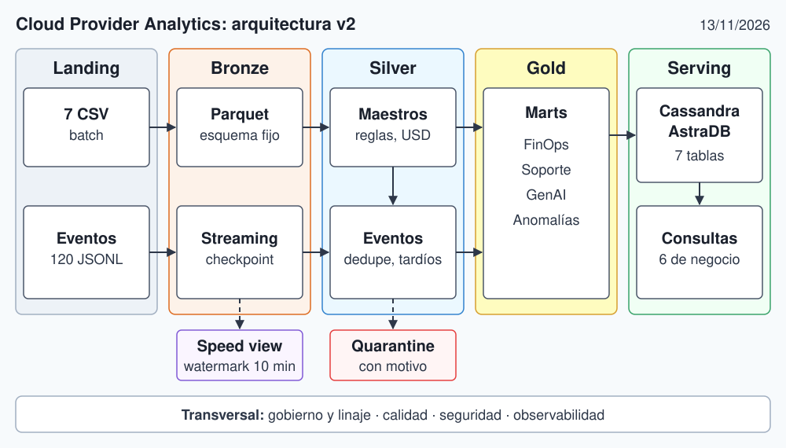

# Diagrama de arquitectura

**Versión 2, 13/11/2026 (segunda entrega).** Muestra lo que está implementado en `src/cpa/`:
es una vista de alto nivel y el detalle de cada capa está en `docs/decisiones.md`. Cambios
respecto de la versión 1:

- Bronze de eventos particionado por fecha de llegada (`ingest_date`), Silver por fecha de evento (ADR-010).
- Late data con umbral manual en `foreachBatch`; el watermark nativo queda en la vista de velocidad (ADR-011).
- Dedupe por `event_id` contra Silver en lugar de `dropDuplicates` con watermark (ADR-012).
- Serving con `cassandra-driver` desde `foreachPartition` y 7 tablas query-first (ADR-013).
- Componente analítico: anomalías de costo por MAD (ADR-014).
- Quarantine única con disposición `rejected` / `remediated` (ADR-015).
- Capacidades transversales agrupadas en Gobierno (catálogo, linaje, propiedad), Calidad, Seguridad y Observabilidad.

El SVG es el archivo editable. [`arquitectura-v1.png`](arquitectura-v1.png) es la versión de la
primera entrega. Si cambiamos algo en el código que afecta al diagrama, lo actualizamos en el
mismo PR.
